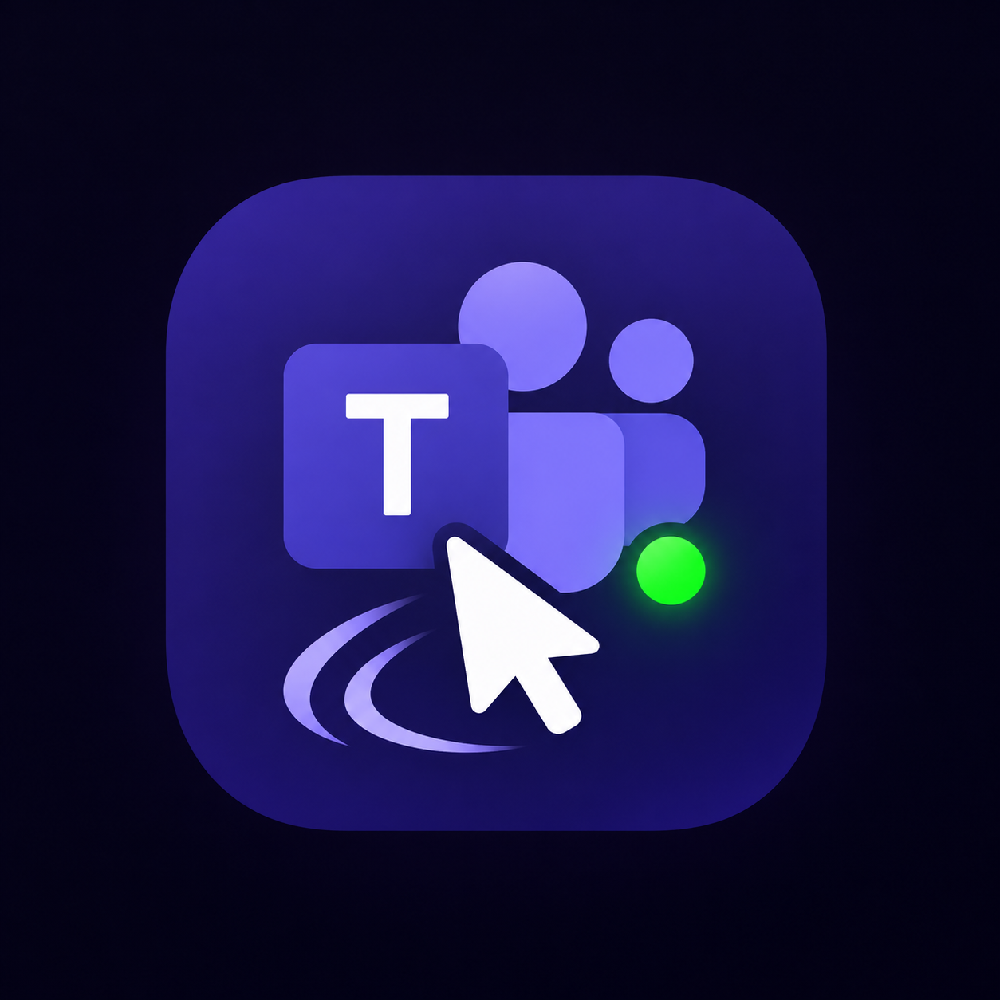
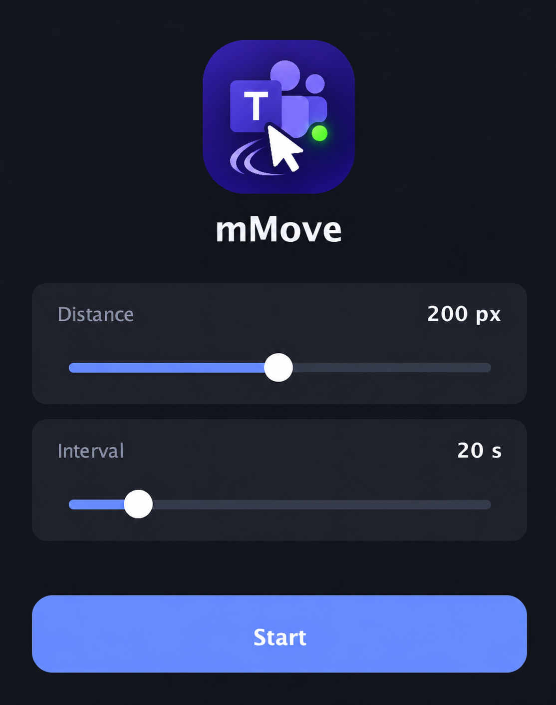

# Building mMove, a small desktop utility with Java Swing

mMove is a desktop utility for the moments when you step away from the keyboard but still want to see what’s happening on screen. Press **Start** and it moves the mouse pointer a short distance to the right and back at a regular interval. Press **Stop** or close the window to end the scheduled movement.



## Two controls and a status line

The **Distance** slider controls how far the pointer moves, from 1 to 400 pixels. The **Interval** slider controls the delay between cycles, from 1 to 120 seconds. The defaults are 200 pixels and 20 seconds. Both settings take effect while the app runs, and the status line shows when the last cycle finished.



The app generates mouse activity. Screen locking, sleep and presence in apps such as Microsoft Teams still follow their own rules. On macOS, the app runs with standard user privileges and needs Accessibility permission to move the pointer.

## Moving the real pointer with Java AWT

At the start of each cycle, Java AWT’s `MouseInfo` reads the current pointer coordinates. A `Robot` moves the pointer horizontally in small steps and then returns it to the starting coordinates. Reading the position at the beginning of every cycle means the app starts from wherever you last left the pointer.

## Keeping the Swing window responsive

A single scheduled worker runs the movement. The first cycle starts immediately, and each subsequent cycle starts after the previous one finishes and the configured delay elapses. If you change a slider while the app is running, mMove replaces the schedule with one that uses the new settings.

Swing handles the controls and status display on the event dispatch thread. When a cycle finishes, the worker posts an update back to Swing. The app checks that the update belongs to the current schedule before displaying it, so a callback from an earlier schedule can’t overwrite the current status.

## Running and packaging mMove

To try it from source, run this command from the project directory with JDK 22 or later. Then press **Start** in the window.

```sh
java --class-path . src/main/java/io/github/giannisdal/mmove/MMove.java
```

The macOS app bundle and Windows app image each include a Java runtime. On macOS, enable mMove under **System Settings → Privacy & Security → Accessibility**. When running from source, grant that permission to the terminal you use to launch it.

The [mMove repository](https://github.com/giannisdal/m-movement) contains the source and build instructions for both platforms.
